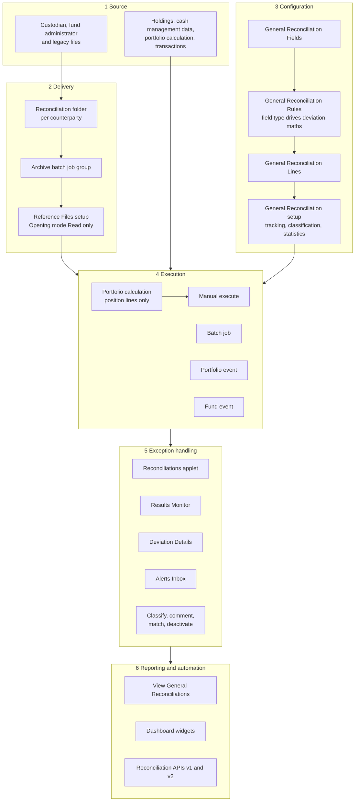
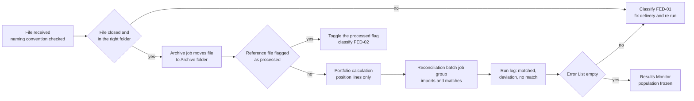
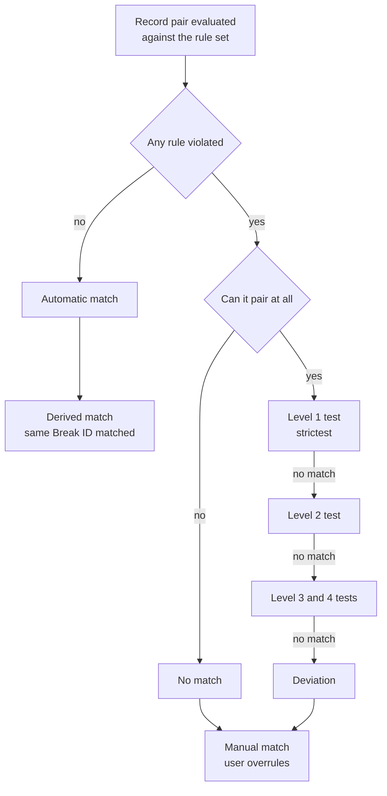
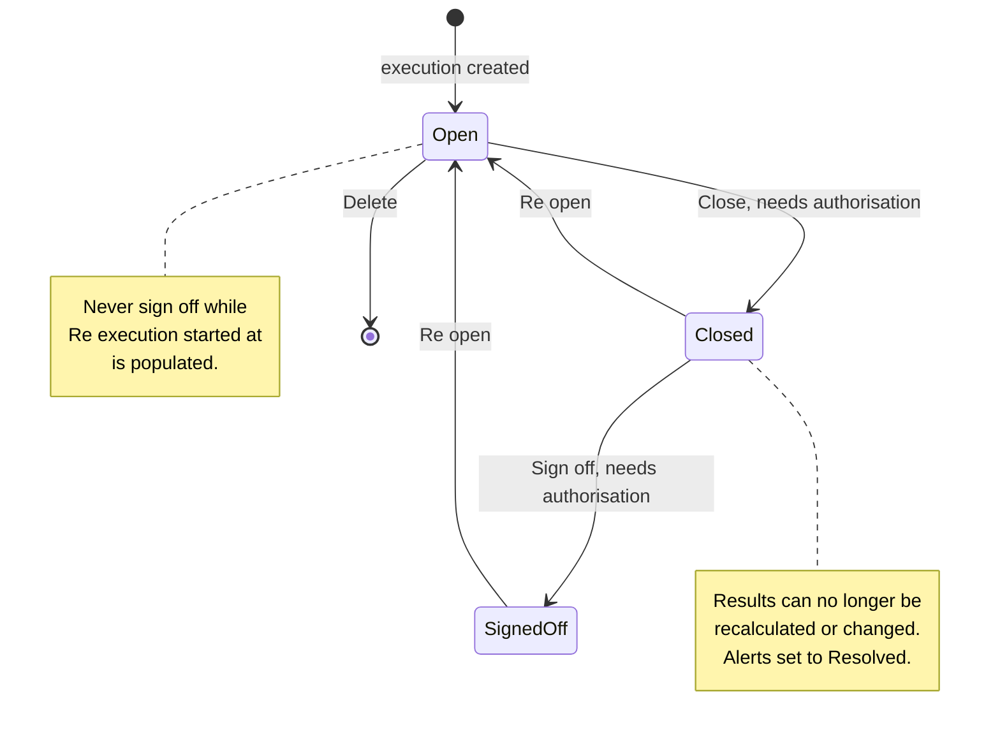
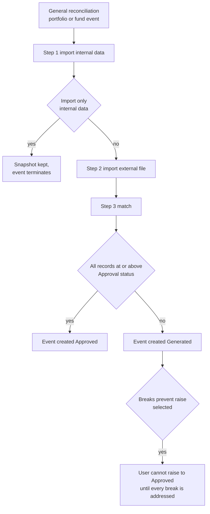
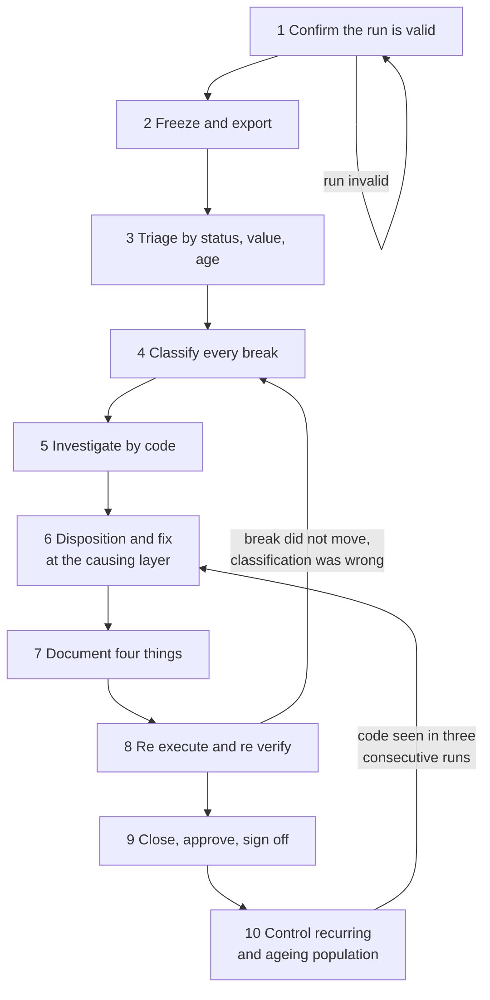
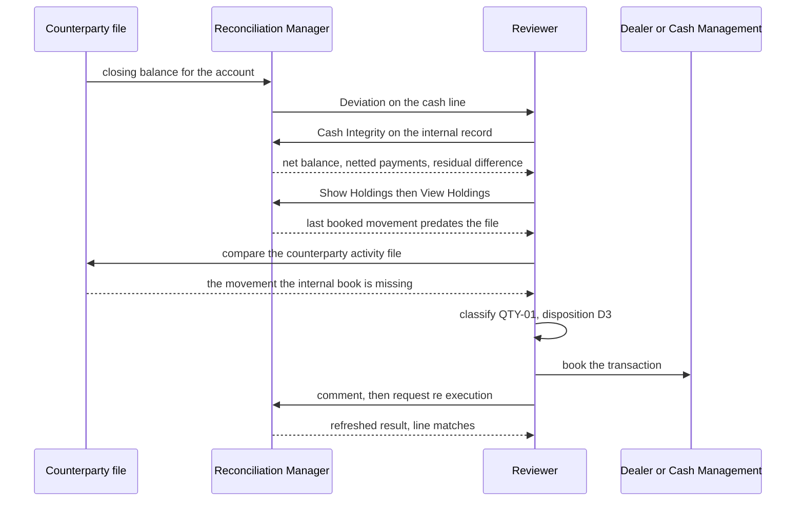
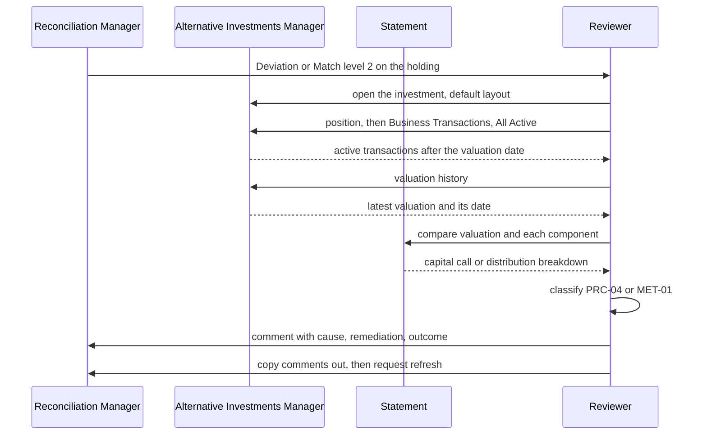
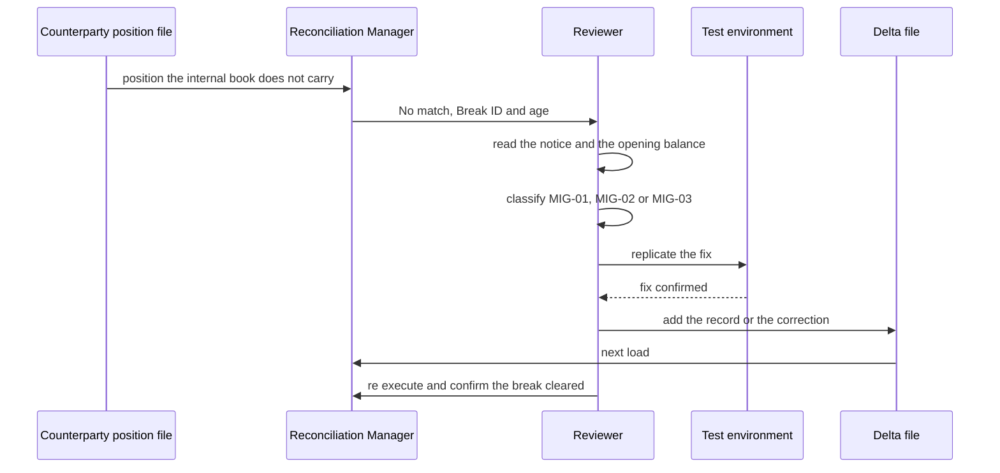

# The diagram set

Nine diagrams, drawn in this order: architecture, then flow, then state, then decision, then
sequence. Every node is source tagged to a manual section or a verified client object. A step
that cannot be tagged does not become a node; it goes to the open questions list.

Shared styling. Near monochrome with one accent. Use this class block in every diagram so the
set reads as one system.

```
classDef ext fill:#F2F4F7,stroke:#9AA4B2,color:#3A3A4A
classDef scd fill:#E4E9F2,stroke:#5B6B8C,color:#1E2761
classDef act fill:#FFFFFF,stroke:#1E2761,color:#1E2761
classDef ctl fill:#FBF3E2,stroke:#A66E08,color:#7A5206
```

Use `ext` for anything outside SimCorp, `scd` for SimCorp objects, `act` for a human decision,
`ctl` for a control that can block progress. Never colour by counterparty or by domain; the
skeleton stays identical across domains and the difference is written in a rule bar of text
above the diagram.

## D1. Solution architecture, six layers



## D2. Daily custodial run, one counterparty



## D3. Break status assignment, how the engine decides



## D4. Execution lifecycle, which is not the record status



## D5. Straight through processing control



## D6. The ten stage process



## D7. Sequence, custodial cash break with a missing transaction



## D8. Sequence, alternatives market value break



## D9. Sequence, migration opening balance break


