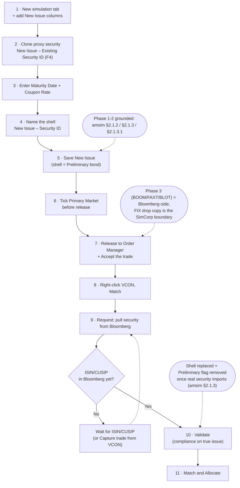

# New Issues Workflow (BOOM) — Wealth-Manager Client (anonymized)

**Source:** client workflow doc *"New issues workflow BOOM.docx"* (8 embedded screenshots).
**Grounded in:** *Simulations in Asset Manager* (SimCorp Dimension User Manual, September 2025 / 2510), §2.1.2 *Create new issues for bonds*, §2.1.3 *Copy existing bond-like securities as proxies for new issues*, §2.1.3.1 *Update security IDs on primary market positions*, and the "New issue flow after releasing to Order Manager" subsection of §2.1.3.
**Not SimCorp-grounded:** Part B (Bloomberg **BOOM / FAXT / BLOT / VCON**) — these are Bloomberg Terminal functions, out of scope of the SimCorp manuals; preserved as client wording and flagged.

> How to read this file: `[[IMAGE: file.png]]` markers show exactly where each screenshot goes when you paste into SharePoint. All images are in the `assets/` folder next to this file. Manual citations are given inline as *(amsim §x.x)*. Items needing a human check are collected under **Open questions**.

---

## Q: How do I book a new issue (a security that doesn't exist yet in SimCorp) and get it to the Order Manager?

**A:** Create a *shell* (preliminary) security in **Asset Manager** by cloning an existing similar security, save it as a new-issue simulation, release it to **Order Manager**, and there match/allocate it against the executed trade — pulling the real security details from Bloomberg before you validate against compliance. The shell's placeholder identifier is replaced with the real ISIN/CUSIP once Bloomberg has published it.

---

### Phase 1 — Create a shell for the new issue (Asset Manager)

*Grounded in amsim §2.1.3 "Copy existing bond-like securities as proxies for new issues" (steps 1-10) and §2.1.2.*

1. Open a **new simulation tab** in **Asset Manager** and add the additional **New Issue** columns (right-click a column header → **Select Fields** → add all **New Issue** fields to the **Create Simulations** window). *(amsim §2.1.3 steps 1-3)* [[IMAGE: 01_create-shell_new-simulation-columns.png]]
2. Choose an existing security that is similar in nature to the new issue (currency, coupon structure, etc.) to **clone**, and enter its ISIN in the **New Issue – Existing Security ID** field (press **F4** in that field to open the **Select New Issue** picker; the list is filtered to the matching sub-instrument type). This copies the proxy's interest/redemption conventions, market conventions, free codes, ratings and security-group codes onto the new issue. *(amsim §2.1.3 step 5)*
3. Fill in the details specific to the new issue:
   - **Maturity Date** — enter a tenor (e.g. `5Y`) or an explicit date in **New Issue – Maturity Date**. *(amsim §2.1.3 step 7)*
   - **Coupon Rate** — enter **New Issue – Coupon Rate** (open for input only when the interest type allows it). *(amsim §2.1.3 step 9)*
4. Type a name for the shell in the **New Issue – Security ID** field (mandatory, together with **New Issue – Security No.**; a name can auto-generate if Security Name Generation rules exist for Bonds). *(amsim §2.1.3 step 8)*
5. Click **Save New Issue** to create the shell. *(amsim §2.1.3 step 10)* [[IMAGE: 02_create-shell_save-new-issue.png]]

> After you click **Save New Issue**, the New Issue input fields clear and the row becomes a saved new-issue **simulation**. The security is saved as a **preliminary bond** — the **Preliminary** flag is selected by default — so it can be enriched later and cannot yet trade in the secondary market. *(amsim §2.1.3, "This bond is saved as a preliminary bond…")*

6. Once the simulation is created, make sure the **"Primary Market"** box is ticked **before** releasing the trade to Order Manager. [[IMAGE: 03_create-shell_primary-market-tick.png]]

> **Client wording preserved — needs confirmation.** The manual documents that the **New Issue – ISIN** field carries a default placeholder value of `PRIMARY_MARKET` (replaced with the real ISIN once the primary-market vendor publishes it), shows a **"Primary Mkt"** portfolio view, and sets the **Preliminary** flag by default *(amsim §2.1.3, §2.1.3.1)*. The exact **"Primary Market" tick box** the client refers to is not spelled out as a checkbox in the pages reviewed — confirm against the screenshot whether it is (a) a grid checkbox column, (b) the `PRIMARY_MARKET` ISIN placeholder, or (c) the **Preliminary** flag. See **Open questions**.

---

### Phase 2 — Route to Order Manager and match/allocate

*Concept grounded in amsim §2.1.3 "New issue flow after releasing to Order Manager": after converting the simulation to an order and releasing it to Order Manager, you replace the shell security via the **Capture Trade** or **Match Unsolicited Executions** windows, issuing a missing-security request to the data provider if the security is not yet in SimCorp Dimension; once the security imports, the **Preliminary** flag is removed.*

7. In **Order Manager**, right-click the trade you just released from Asset Manager and hit **Accept**.
8. Right-click the **VCON** and hit **Match**.
9. In the **"Match"** window, click **Request** to pull the security details from Bloomberg — you can use any of the identifiers in the dropdown. *(Concept: amsim §2.1.3 "search for a security in SimCorp Dimension… / issue a missing security request to the data provider")* [[IMAGE: 04_order-manager_match-request-bloomberg.png]]
10. Once the security details are pulled from Bloomberg, click **Validate**. This validates the security parameters against compliance rules — remember the shell created in Asset Manager had **not** completed compliance checks against the *true* new issue. *(Concept: amsim §1.1 "Apply pre-trade compliance validation… before converting into real portfolio orders"; §2.1.3 shell-replacement flow)* [[IMAGE: 05_order-manager_validate-compliance.png]]
11. Finally, click **Match and Allocate**.

> **Note (client, verbatim):** If the ISIN is not generated for the new issue on Bloomberg yet, you cannot match/allocate the trade and need to wait until the ISIN/CUSIP is in Bloomberg before you can match. *(Consistent with amsim §2.1.3: "issue a missing security request… the order shell security is updated with the requested identifier… After the security is imported successfully, the Preliminary flag is removed.")*

> **Note (client, verbatim):** You can always manually **"Capture"** a trade and fill in the ticket based on the VCON as a workaround. *(Consistent with amsim §2.1.3: replace the shell security via the **Capture Trade** window.)*

> Example identifier seen in the client screenshot: `CA292976UX36` (illustrative only).

---

### Phase 3 — Access to BOOM in UAT (Bloomberg money-market programmes)

> **Scope note:** **BOOM**, **FAXT**, **BLOT**, **BBLP**, **VCON** and the **FIX drop copy** are **Bloomberg Terminal** functions/objects, not SimCorp Dimension features. They are **not covered by the SimCorp manuals** and are reproduced here as client wording (verbatim) for completeness. The SimCorp boundary is where the Bloomberg **FIX drop copy** flows into SimCorp. `UNVERIFIED against SimCorp manuals — Bloomberg-side.`

To check money-market programmes in BETA (client wording, verbatim):

12. Run **`FAXT BETA <go>`** on Bloomberg.
13. Run **`BOOM <go>`** and, under **99) Settings**, flag **DEMO mode ON**.
14. You will then be able to see programmes and the Dealer **BBLP** (Test Bloomberg dealer/issuer).
15. Click into any rate (yellow field) — e.g. 7-Eleven maturing 11/21/25. [[IMAGE: 06_boom-uat_boom-go.png]]
16. The trade ticket opens; hit **Submit** (or switch between maturities bottom-left). [[IMAGE: 07_boom-uat_trade-ticket.png]]
17. Once the trade order is submitted it is auto-accepted and shows in your blotter — **`BLOT <go>`**. Click into it to see the details of the trade that will flow to SimCorp. The **FIX drop copy** then flows to SimCorp. [[IMAGE: 08_boom-uat_run-blot-blotter.png]]

---

## Diagram

---

## Setup / prerequisites

- **New Issue fields visible in the grid** — add all **New Issue** fields to the **Create Simulations** window via **Select Fields** (Required). *(amsim §2.1.3 step 3)*
- **Add security identifiers authorisation** — the **Add security identifiers** command must be authorised in the **Tasks and Commands** menu of the **Portfolio Sheet** applet if you will add market IDs (ISIN/CUSIP/FIGI) to the new-issue positions. (Recommended) *(amsim §2.1.3.1)*
- **Security identification systems** — alternative identifiers (e.g. FIGI) must be enabled with **Include in new security request** in the **Security Identification Systems** window; the ID type must exist in the relevant **Data Format Setup** search field, or a new security can be created inadvertently. (Recommended) *(amsim §2.1.3.1)*
- **Security Name Generation rules** for Bonds (optional) let the shell name auto-generate. *(amsim §2.1.3 step 8)*

---

## Open questions (dissent + wording drift to confirm before publish)

1. **"Primary Market" box (Phase 1, step 6) — wording drift, needs screenshot confirmation.** Client says "make sure the *Primary Market* box is ticked before releasing." The manual documents (a) the **New Issue – ISIN** default placeholder value `PRIMARY_MARKET`, (b) a **"Primary Mkt"** portfolio view/tab, and (c) the **Preliminary** flag (on by default) — but does not, in the pages reviewed, describe a tickable **"Primary Market"** checkbox on the simulation grid. Confirm which control the client means. Preserve the client's word either way.
2. **Order Manager button labels (Phase 2, steps 7-11) — `UNVERIFIED against manual`.** The *concept* (Accept the released order → match the unsolicited execution/VCON → request/import the missing security → validate against compliance → allocate) is grounded in amsim §2.1.3's "New issue flow after releasing to Order Manager" (Capture Trade / Match Unsolicited Executions / missing-security request). The exact button captions **Accept**, **Match**, **Request**, **Validate**, **Match and Allocate**, and the term **VCON**, are the client's Order Manager wording and were not confirmed against a specific Order Manager / Order Outbox manual section. Confirm labels against the Order Manager applet before publishing as authoritative.
3. **Phase 3 (BOOM/FAXT/BLOT/BBLP/VCON/FIX drop copy) — `UNVERIFIED against SimCorp manuals — Bloomberg-side`.** These are Bloomberg Terminal functions, out of SimCorp manual scope. Reproduced verbatim as client instructions. Confirm with the Bloomberg admin / whoever owns the UAT BOOM access if this section is to be published as SimCorp SOP, or split it into a separate "Bloomberg BOOM (UAT)" note.
4. **Minor label casing:** client "New Issue – Existing Security ID / New Issue – Security ID" vs manual "New Issue - Existing security ID / New Issue - Security ID" — cosmetic; align on publish.

---

## Image placement manifest

| # | Step (phase) | Image file |
|---|---|---|
| 1 | Phase 1, step 1 — new simulation tab + add New Issue columns | `assets/01_create-shell_new-simulation-columns.png` |
| 2 | Phase 1, step 5 — Save New Issue (creates the shell) | `assets/02_create-shell_save-new-issue.png` |
| 3 | Phase 1, step 6 — tick "Primary Market" before release | `assets/03_create-shell_primary-market-tick.png` |
| 4 | Phase 2, step 9 — Match window, Request (pull from Bloomberg) | `assets/04_order-manager_match-request-bloomberg.png` |
| 5 | Phase 2, step 10 — Validate against compliance | `assets/05_order-manager_validate-compliance.png` |
| 6 | Phase 3, step 15 — BOOM `<go>` (Bloomberg) | `assets/06_boom-uat_boom-go.png` |
| 7 | Phase 3, step 16 — trade ticket (Bloomberg) | `assets/07_boom-uat_trade-ticket.png` |
| 8 | Phase 3, step 17 — Run BLOT to see ticket in blotter (Bloomberg) | `assets/08_boom-uat_run-blot-blotter.png` |

**CID / email-embedded images:** none — all 8 screenshots were recoverable raster files (no re-capture needed).

---

## Publishing to SharePoint (reminder)

SharePoint modern pages do **not** render Markdown or mermaid. Paste the prose via the Text web part; at each `[[IMAGE: ...]]` marker insert the matching file from the manifest (Insert → Image → Upload, or from Site Assets). Render the mermaid diagram to PNG/SVG first (mermaid live editor or `mmdc`) and insert it as an image. Do **not** publish the **Open questions** items as settled fact until confirmed.
