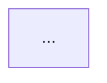

# SimCorp FAQ Builder (MiroFish 3-layer)

Convert a raw client workflow document into a publish-ready FAQ / SOP that is
grounded in the SimCorp manuals, carries its screenshots correctly, and can be
pasted into SharePoint, ClickUp, or the Notion Wiki. Use this whenever the
deliverable is knowledge for other people to follow — not a data extraction (use
`simcorp-extraction`) and not a one-off Q&A answer (use `simcorp-super-agent`).

The reason this skill exists: client procedure docs are written by practitioners in
their own words, with screenshots that are locked inside the file and steps that are
often the client's terminology rather than the SimCorp manual's. Publishing them
verbatim spreads unverified wording and loses the images. This skill grounds every
step, recovers and places every image, and flags where client wording diverges from
the manual so a human can decide — rather than silently "correcting" the client.

Run all three layers in order. Do not skip.

---

## Layer 1 — GraphRAG Digital Twin (Grounding)

Establish the structural truth before writing anything.

1. **RAG-first gate.** Run the SimCorp RAG gate; if the knowledge base is
   unreachable, STOP and flag — never ship inferred SimCorp facts.
2. **Ingest the source doc.** Extract its text in reading order, and extract every
   embedded image with `scripts/extract_doc_images.py` (see below). The script maps
   each image to the step text that precedes it.
3. **Ground every step.** For each procedure step, find the authoritative source —
   the current SimCorp manuals (Sept-2025 / 2510 set in `ii. Manuals &
   Documentation/`) and/or the Notion Wiki + Solution Architecture. Record the
   manual name + section for each step. If a step cannot be grounded, mark it
   `UNVERIFIED` — do not invent a field, window, or menu name to fill the gap.
4. **Flag wording drift.** Where the client's term differs from the manual's term
   (e.g. client "Primary Market" tick vs manual "Preliminary" field), record BOTH
   and mark it for human confirmation. Never overwrite the client's word silently.

**Output of Layer 1:** grounded step list (each with source § or `UNVERIFIED`),
image→step map, and a wording-drift list.

---

## Layer 2 — Technical Committee Swarm (Design)

Run three personas in dialogue. Loop until two of three concur; log any dissent —
never silently overrule.

| Persona | Lens | Cares about | Critique vector |
|---------|------|-------------|-----------------|
| **Content Architect** | Reuse + structure | "Does a Wiki/FAQ entry already exist to extend? What's the cleanest Q→A→steps shape?" | Duplication, sprawl, burying the answer |
| **Manual-Grounding Auditor** | Correctness | "Is every step cited to a manual §? Is any wording drift flagged, not hidden?" | Ungrounded claims, silent client-wording overwrite, invented names |
| **SharePoint Publishing Agent** | Delivery | "Will this render where it's going? Are images placed and reachable? Diagrams parse?" | Mermaid that won't render in the target, missing/CID-only images, dead links |

**Debate protocol:**
1. Architect proposes the FAQ/SOP structure (extend existing Wiki if one exists).
2. Auditor stress-tests grounding and wording drift.
3. Publishing Agent stress-tests target rendering and image placement.
4. Re-iterate until 2 of 3 concur; log dissent as an "Open Questions" section.

**Output of Layer 2:** the FAQ/SOP draft + image placement plan + dissent log.

---

## Layer 3 — Simulation Sandbox (Validation)

Run these failure-mode checks before the deliverable ships.

| Check | What it tests | Mitigation if it fails |
|-------|---------------|------------------------|
| Missing image | Any step whose screenshot is CID/email-embedded and not a real file | Flag as "screenshot to re-capture"; never fabricate it |
| Ungrounded step | Any step still marked `UNVERIFIED` | Escalate to human or `simcorp-super-agent`; do not publish as fact |
| Wording drift | Any client-vs-manual term not surfaced for confirmation | Add to the confirmation list before publish |
| Mermaid parse | Every diagram actually parses in the target renderer | Parse-check each block (see references); fix before ship |
| Dead link / path | Any image reference that won't resolve after upload | Use relative asset names + a manifest the human uploads against |

**Output of Layer 3:** validated deliverable + risk/confirmation list.

---

## Image handling & SharePoint publishing

The NWM tenant blocks the Graph API and no SharePoint connector is assumed, so this
skill does **not** push to SharePoint. It prepares everything for a one-time human
upload. See `references/sharepoint-publishing.md` for the full procedure. In short:

- Extract images with `scripts/extract_doc_images.py <doc>` → writes named PNGs to an
  `<deliverable>_assets/` folder and prints an image→step map.
- Name each file by step, e.g. `03_primary-market-tick_before-release.png`.
- Emit a **placement manifest**: for each step, the image filename to insert.
- CID/email-embedded images (common when a Bloomberg email was pasted in) are
  references, not files — they cannot be recovered. List them as "re-capture".
- In the FAQ/SOP body, put an explicit marker at each step:
  `[[IMAGE: 03_primary-market-tick_before-release.png]]` so the human knows exactly
  where to drop each screenshot in the SharePoint page editor.

---

## Output format

Produce a single copy-paste-friendly Markdown deliverable with these sections. Keep
diagrams simple and annotated (dotted note nodes for callouts, not dense graphs).

```markdown
# <Workflow name> — <Client, anonymized>
Source: <client doc>; grounded in <manuals + §>.

## Q: <the question a reader would ask>
**A:** <one-line answer>

### <Phase / section>
1. <step> [[IMAGE: <file>]]   <!-- cite § inline or in a footnote -->
...
> Note / gate / workaround (verbatim client wording preserved)

## Diagram


## Setup / prerequisites (if asked)
<required config windows, each cited to a manual §; required vs recommended>

## Open questions (dissent + wording drift to confirm)
- <client term> vs <manual term> — confirm against screenshot
- <UNVERIFIED step> — needs grounding

## Image placement manifest
| Step | Image file |
```

---

## Constraints (apply in every layer)

- **RAG-first**, and if the KB is unreachable, STOP — never ship inferred facts.
- **Never invent** a table, column, field, window, or menu name. Trace to a manual §
  or the Wiki, or mark `UNVERIFIED`.
- **Preserve client wording**; surface drift for confirmation, don't overwrite.
- **Anonymize client names** (Nicola Wealth, NWM) in published output.
- **Every mermaid block must parse** before ship (parse-check, don't eyeball).
- **Ground in the current 2510 / Sept-2025 manuals**, not superseded AIM 24.07.
- **Preceding = `Last360`** for any business-day snap, never `Same`.

---

## HITL gates

1. After Layer 1: present the grounded step list + wording-drift list. "Grounding
   look right? Any step you want re-sourced before I design the FAQ?"
2. After Layer 2: present the FAQ/SOP structure + dissent log. "This shape work?"
3. After Layer 3: present the validated deliverable + image manifest + confirmation
   list. "Ready to publish? These items need your confirmation first."

---

## What this skill does NOT do

- Does NOT push to SharePoint/ClickUp/Notion (prepares copy-paste + manifest).
- Does NOT fabricate missing (CID) screenshots.
- Does NOT overwrite client terminology — it flags divergence.
- Does NOT answer standalone config questions — that's `simcorp-super-agent`.

---

## Reference files

- `scripts/extract_doc_images.py` — extract + name + map embedded images from a
  docx (and list CID-only images that can't be recovered).
- `references/sharepoint-publishing.md` — image upload procedure, target-renderer
  notes (SharePoint / ClickUp / Notion), mermaid parse-check snippet.
- `references/faq-template.md` — the full FAQ/SOP skeleton with worked BOOM example.
