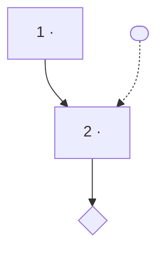

# FAQ / SOP skeleton + worked example

Use this as the output skeleton. Keep diagrams simple and annotated (dotted note
nodes for callouts). Preserve client wording; flag drift in Open Questions.

## Skeleton

```markdown
# <Workflow name> — <Client, anonymized>
Source: <client doc>; grounded in <manual + §>.

## Q: <question a reader would ask>
**A:** <one-line answer>.

### Phase 1 — <name>
1. <step> [[IMAGE: <file>]]
2. <step>
> Note / gate / workaround (client wording verbatim)

### Phase 2 — <name>
...

## Diagram


## Setup / prerequisites (if asked)
Required: <config window> — <what to set> (<manual §>)
Recommended: ...

## Open questions (confirm before publish)
- <client term> vs <manual term> — confirm against screenshot
- <UNVERIFIED step> — needs grounding

## Image placement manifest
| Step | Image file |
```

## Worked example — Nicola BOOM new-issue workflow

- **Layer 1:** extracted 8 PNGs (image1–8) mapped to steps; 3 Bloomberg images were
  CID-only → flagged re-capture. Grounded steps in *Simulations in Asset Manager*
  §2.1.3 (clone existing security = Method A) and the Order Manager match flow.
  Wording drift found: client "Primary Market" tick vs manual "Preliminary" field.
- **Layer 2:** Architect → Q&A + phased steps; Auditor → cited each step, flagged the
  Primary Market/Preliminary drift; Publishing Agent → `[[IMAGE]]` markers +
  manifest, mermaid parse-checked. Consensus reached.
- **Layer 3:** missing-image (3 CID) flagged; no ungrounded steps; drift surfaced;
  mermaid parsed; asset paths relative. Ship with confirmation list.

This is the reference standard for what "done" looks like: every step cited, every
recoverable image named and placed, every divergence surfaced for the human.
